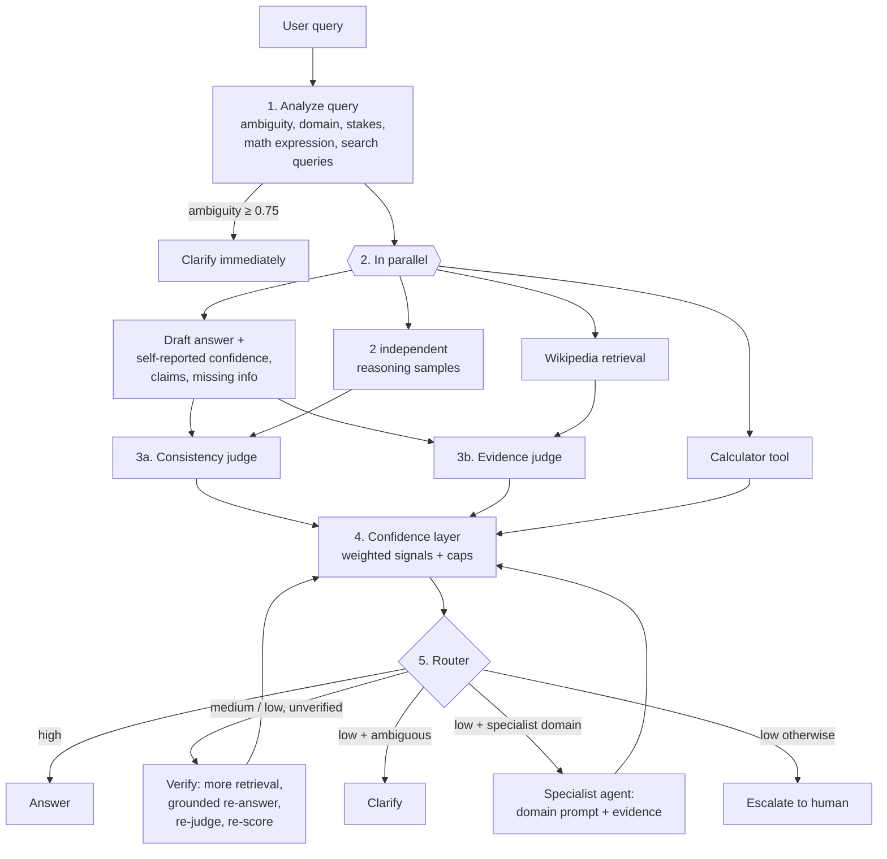
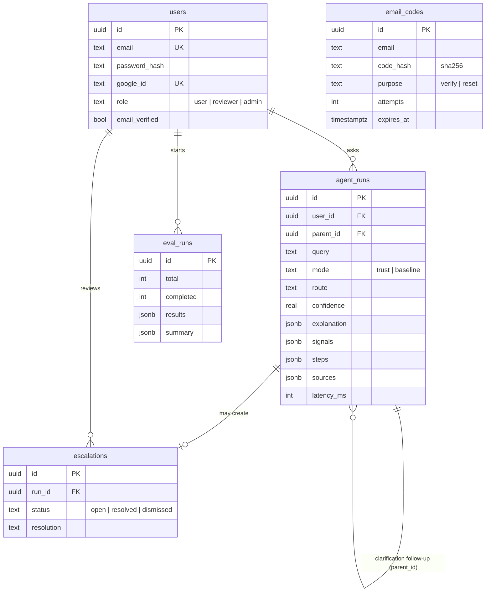

# Architecture

## 1. System overview

```mermaid
flowchart LR
  U[User browser<br/>React SPA on Vercel] -- REST + JWT --> API[Express API<br/>Render]
  U <-- Socket.IO (JWT) --> API
  API --> DB[(Neon PostgreSQL)]
  API --> LLM[LLM: Mistral API (cloud)<br/>or local Mistral 7B GGUF]
  API --> WIKI[Wikipedia API<br/>evidence retrieval]
  API --> MAIL[Brevo email]
  UR[UptimeRobot] -- GET /health --> API
  R[Reviewer browser] <-- Socket.IO --> API
```

- **Frontend** (`frontend/`): single-page React app. Talks to the API over REST and keeps one authenticated Socket.IO connection for live updates.
- **Backend** (`backend/`): stateless Express server (except the in-memory per-user concurrency counter and the single-evaluation lock). Agent runs execute in the background after the HTTP request returns `202 Accepted`; progress is streamed over the socket.
- **Database**: PostgreSQL (Neon). The schema is applied idempotently at boot (`src/db/schema.sql`).

## 2. The trust-aware agent pipeline

Implemented in `backend/src/agent/trustAgent.js`.



The loop is bounded (`MAX_LOOPS = 3`): verification and the specialist hand-off each happen at most once.

### Components (problem-statement mapping)

| Required component | Where |
|---|---|
| Confidence estimation | `agent/confidence.js` → `scoreConfidence` |
| Uncertainty detection | Query analysis (`QueryAnalysis` schema), self-consistency judge, evidence judge, `missing_information` |
| Verification mechanisms | `agent/tools/wikipedia.js` (retrieval), `agent/tools/calculator.js` (deterministic tool), grounded re-answer |
| Escalation logic | `agent/router.js` + `services/agent.service.js` (escalation record, reviewer emails, realtime) |
| Explainability | `confidence.js` → `explainConfidence`; UI `components/agent/ConfidencePanel.jsx` |
| Monitoring | `routes/monitor.routes.js`, `pages/Monitor.jsx`, audit trail in `agent_runs` |
| Evaluation | `eval/` + `pages/Evaluation.jsx` + `scripts/run-eval.js` |

### LLM usage

All model calls go through the facade `agent/llm.js` (`structured()` and `complete()`), which picks a provider with `LLM_PROVIDER`:

**`mistral` / `api` (cloud deployment) — `agent/providers/openai.js`**
- Any OpenAI-compatible Chat Completions API; default Mistral AI (`https://api.mistral.ai/v1`, `ministral-8b-latest`, free Experiment plan).
- Structured output via `response_format: json_schema` (automatic fallback to `json_object` if unsupported), schema also stated in the system prompt; replies are parsed, numeric strings coerced and validated with Zod, with one retry on invalid JSON.
- Free tiers allow ~1 request/second: calls go through a queue spaced by `LLM_API_MIN_INTERVAL_MS`, and 429/5xx responses are retried with backoff (honouring `Retry-After`).
- Serial like the local model: 1 self-consistency sample by default, evaluations run one scenario at a time.

**`local` (development default) — `agent/providers/local.js`**
- Loads `LLM.gguf` from the project root (Mistral 7B Instruct v0.2) in-process with **node-llama-cpp**, once, in the background at boot.
- Each Zod schema is converted to JSON Schema and compiled into a **GBNF grammar**, so the model can only generate valid JSON for that schema; the result is then validated with Zod. Arrays are capped at 4 items to keep generations short.
- The model has one context sequence; calls are serialised through a queue and each call starts from a cleared history. Parallel agent stages simply wait their turn.
- "Effort" maps to a token budget (`low` 350, `medium` 600). Samples use temperature 0.9 for diversity; other calls 0.2.
- Self-consistency uses `LLM_SAMPLES` extra samples (default 1 on CPU); evaluations run one scenario at a time.
- Small models often report probabilities as percentages; `clamp01` treats values in (1, 100] as percentages.
- `providers/modelDownload.js` fetches the model from `LLM_MODEL_URL` on first boot when the file is missing (cloud hosts).

**`anthropic` (optional) — `agent/providers/anthropic.js`**
- Claude structured outputs (`messages.parse` + `zodOutputFormat`); a `refusal` stop reason raises `LlmRefusalError`, which the agent converts into an escalation.

## 3. Request lifecycle

1. `POST /api/agent/ask` validates input, checks the per-user concurrency limit (2) and hourly rate limit (60), inserts an `agent_runs` row with `status = running` and returns `202 { run }`.
2. The service runs the agent in the background. Each stage emits `run:step` to the room `user:<id>`.
3. On completion the run is persisted (route, confidence, explanation, signals, steps, sources, latency) and `run:complete` is emitted. Monitor viewers receive `monitor:run-completed`.
4. If the route is `escalate`, an `escalations` row is created, reviewers get `escalation:new` and an email. The user sees a hand-off message; the unverified draft is visible only to reviewers.
5. When a reviewer resolves it, the user receives `run:reviewed` live and an email.

## 4. Data model



`agent_runs` is the **audit trail**: it stores every signal value, cap, reasoning step, source and the final decision.

## 5. Security

- Passwords hashed with bcrypt (cost 12). Verification/reset codes stored as SHA-256 hashes, expire after 10 minutes, max 5 attempts, compared in constant time.
- JWT (HS256) for REST and socket handshakes; roles enforced server-side (`requireRole`).
- Google sign-in verifies the ID token signature and audience with `google-auth-library`.
- Helmet headers, strict CORS allow-list, JSON body limit 100 kB, rate limits on auth (50 / 15 min / IP) and questions (60 / hour / user).
- The calculator uses a hardened mathjs instance (`import`, `evaluate`, `parse`, `createUnit`… disabled inside expressions).
- Secrets only in environment variables; `.env` files are git-ignored.

## 6. Frontend structure

```
src/
├── main.jsx               providers: Router → Auth → Socket
├── App.jsx                routes + guards (RequireAuth / GuestOnly), lazy chart pages
├── context/               AuthContext (JWT session), SocketContext (+ useSocketEvent hook)
├── lib/                   api client, socket factory, formatting helpers
├── components/
│   ├── layout/            AppLayout (sidebar, live indicator)
│   ├── agent/             RunCard, StepTimeline, ConfidencePanel
│   ├── auth/              GoogleButton (Google Identity Services)
│   └── ui/                Logo, badges, gauge, spinner
├── pages/                 Landing, auth/*, Agent, History, Monitor, Evaluation, Review, Admin
└── styles/global.css      design tokens (dark + light), layout, components
```
